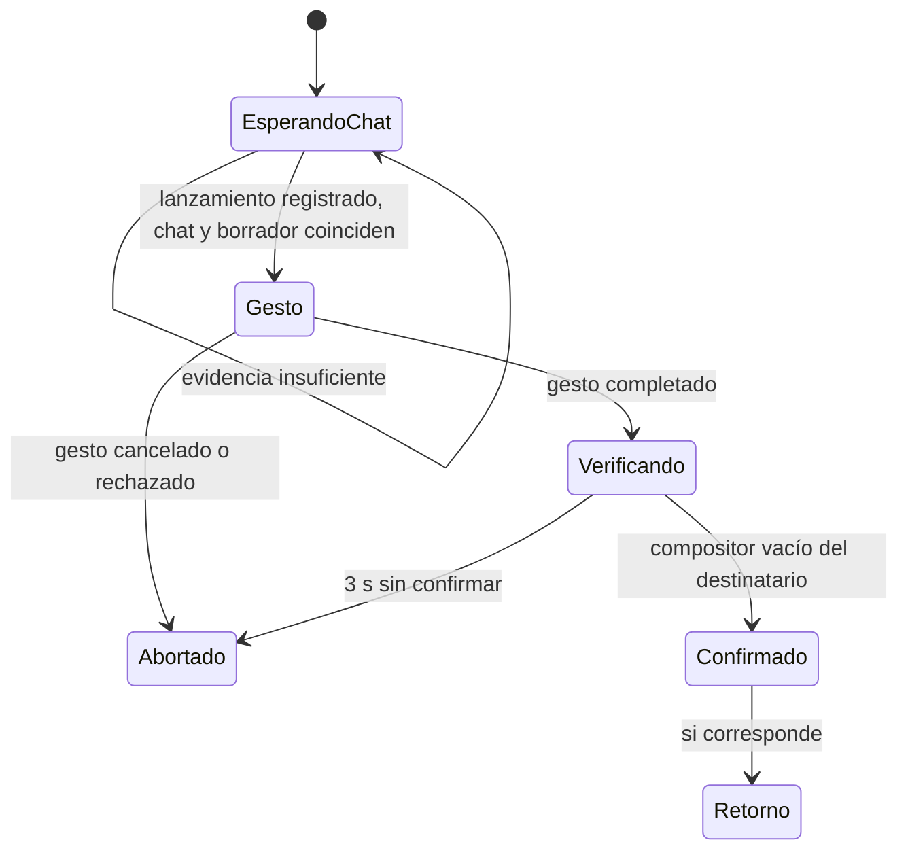
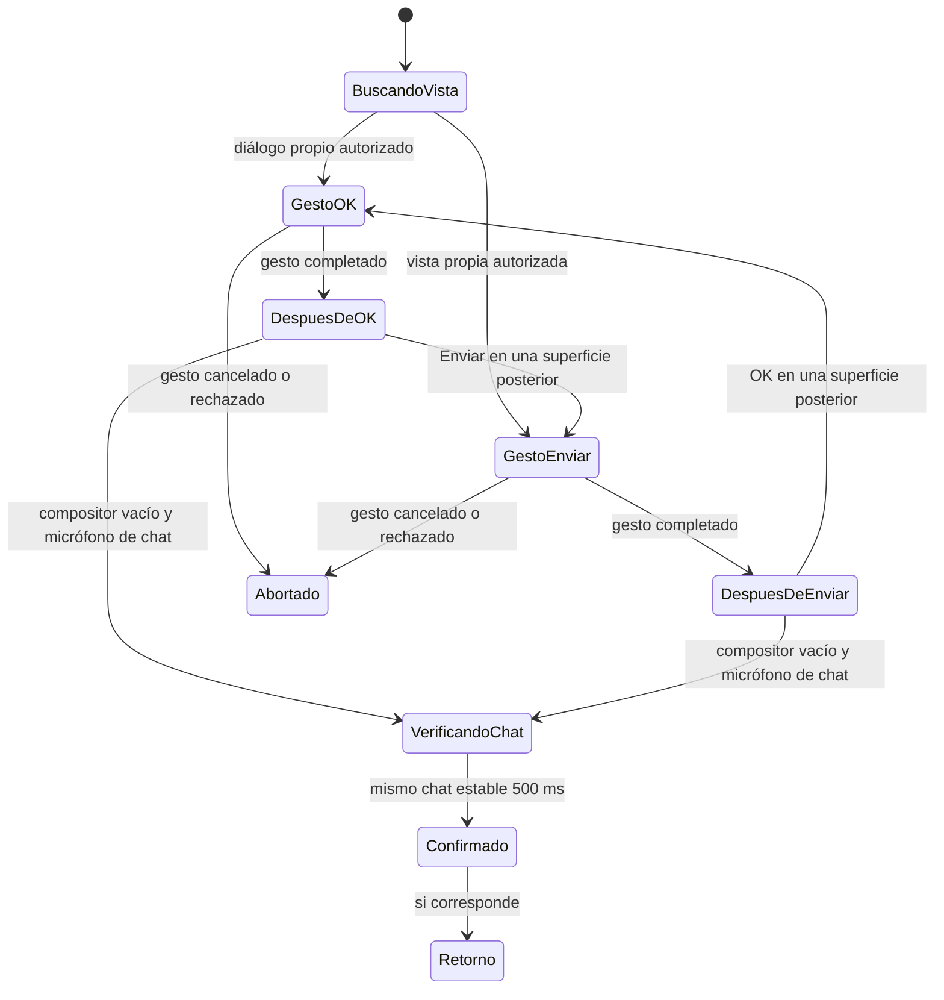

# Arquitectura del asistente flotante

## Envío por WhatsApp

El adaptador de Android lee la ventana activa o la ventana de WhatsApp enfocada.
Convierte su árbol de accesibilidad en un `UiNode` y usa
`WhatsAppScreenReader` para identificar el destinatario, el compositor y los
controles. `AutoSendCoordinator` registra el lanzamiento dirigido, las ventanas
que ya existían y la hora de preparación. Un evento de ventana se vuelve
utilizable cuando se registra el éxito del lanzamiento.

### Texto



### Audio



El registro del paso queda marcado antes de ejecutar cada gesto. El adaptador
comprueba el id de la solicitud antes de entregar resultados o volver a la app
anterior. Los adjuntos generales conservan su ventana de verificación de 3 s.
El audio grabado conserva el plazo de la solicitud dirigida.

## Capturar una pantalla en debug

Las pruebas consumen ejemplos sintéticos en
`app/src/test/resources/whatsapp/` basados en los selectores existentes.
Para guardar la próxima pantalla que el servicio inspeccione en un envío propio,
creá el marcador de captura y reproducí ese envío con un contacto de prueba.

```sh
adb shell run-as com.aistudio.pingassist.qvrtkm touch cache/capture-whatsapp-tree
adb exec-out run-as com.aistudio.pingassist.qvrtkm cat cache/whatsapp-tree.json > whatsapp-tree.json
```

El marcador se consume en una captura. El JSON privado conserva la estructura,
los IDs, las clases, los bounds, los flags y los nombres de controles incluidos
en una lista fija. Los nombres de destinatarios, archivos y textos de mensajes
deben representarse con valores de prueba al preparar el fixture.
